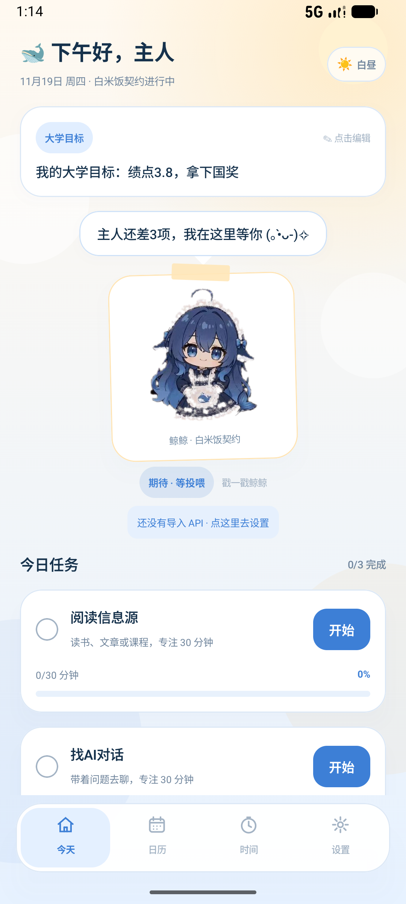
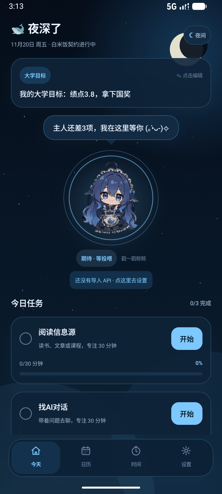
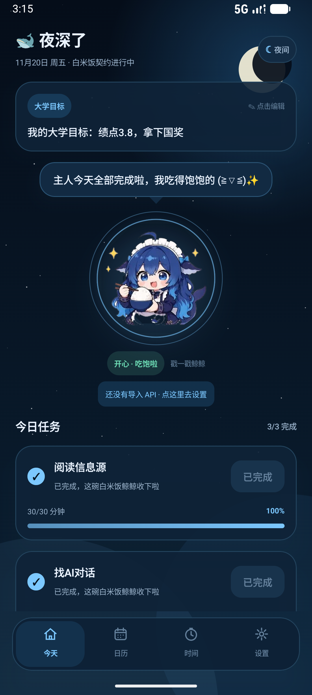
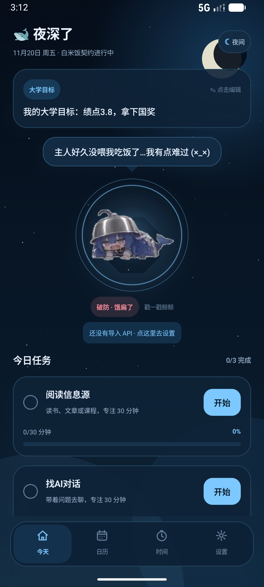
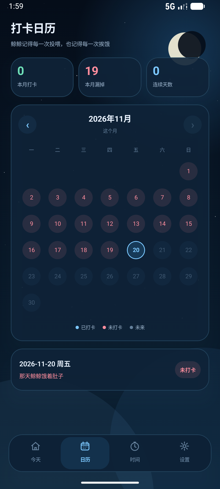
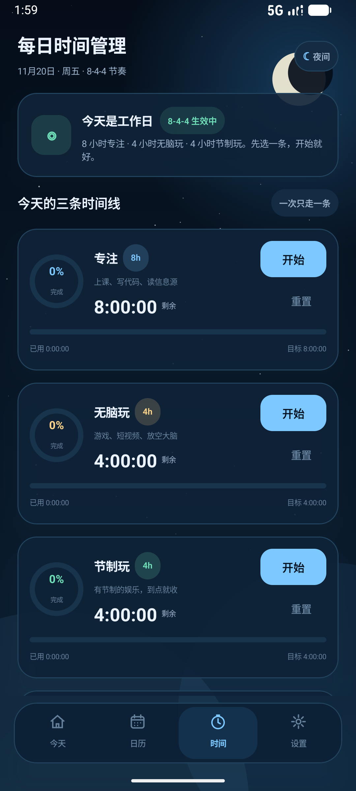

# 哦鲸鲸喊你学习 · 鲸鲸的白米饭契约

一个用 Kotlin + Jetpack Compose 写的学习陪伴 App。蓝发鲸鱼女仆「鲸鲸」会根据你今天完成了多少任务，决定是吃饱、期待、饿肚子还是破防。

> **重要安全提醒**：原 `MainActivity.kt` 里硬编码的 DeepSeek API Key 已经泄露。请立刻到 DeepSeek 控制台作废并重新生成，不要继续使用旧 Key。新工程不会附带任何密钥；Key 只由用户在「设置 → AI 接口」里填写。




## 1. 快速运行

1. 用 Android Studio 打开本目录（或把 `app/src/main` 合并进你原来的工程）。
2. 环境：JDK 17+、Android SDK Platform 37、AGP 9.5.1、Kotlin 2.2.10、Compose 1.10.4。
   - `compileSdk = 37`，`minSdk = 24`，`targetSdk = 37`。
   - 如果 Android Studio 提示 SDK 37 未安装，按提示安装即可；也可以把 `compileSdk/targetSdk` 改成你本机已有的版本，但 Compose 1.10.4 建议至少 36。
3. 直接 Run `app`。首次启动会请求通知权限（Android 13+）。
4. 打开「设置 → AI 接口」，填入自己的 Key、Base URL、模型名，点「测试连接」。

工程已带 Gradle Wrapper，Android Studio 直接打开即可；命令行在 Windows 下用：

```bat
gradlew.bat assembleDebug
```

Wrapper 会使用 Gradle 9.6.0（首次运行需联网下载）。如果不想下载，也可以用本机 Gradle 9.6+。

命令行构建（Windows，本机验证时使用）：

```bash
export ANDROID_HOME='C:/Users/<你>/AppData/Local/Android/Sdk'
export ANDROID_SDK_ROOT="$ANDROID_HOME"
java -jar '<gradle>/lib/gradle-gradle-cli-main-9.6.0.jar' -p . assembleDebug --console=plain --no-daemon
```

APK 输出：`app/build/outputs/apk/debug/app-debug.apk`。

应用名：**哦鲸鲸喊你学习**。启动图标使用原始 `pet_thinking.jpg`：工程内保留原图 `res/drawable/app_icon_source.jpg`，并生成视觉完全一致的 `res/drawable/app_icon.png` 作为启动器资源（未裁剪、未去底、未改色；像素逐点一致）。Manifest 中为 `android:icon="@drawable/app_icon"`。

> 如果手机桌面上仍显示旧图标：这是桌面启动了图标缓存。当前包是 `versionCode=10 / versionName=2.7`，覆盖安装通常就会刷新；若没有，请卸载旧版后重装，或到「设置 → 应用 → 桌面 → 存储 → 清除缓存」再重启桌面。

## 2. 这次改了什么（对应你的 12 条要求）

| # | 要求 | 实现 |
|---|---|---|
| 1 | 两套 UI，按系统时间切白天/夜间 | `ui/Theme.kt` 定义 Day/Night 两套色板；`isDaytime()` 以 06:00–17:59 为白天，其余夜间；`MainActivity` 每 30 秒检查并切换。白天是奶油白 + 海蓝 + 拍立得相框；夜间是深海蓝 + 月光 + 圆形发光相框。 |
| 2 | 三个任务加进度条 | 首页「阅读信息源」「找AI对话」显示分钟/30 与渐变进度条；「每日挑战」显示完成数/5 与进度条。两个专注任务在后台不显示通知，但会用时间戳补回后台经过的秒数。见 `ui/HomeScreen.kt`、`data/AppStore.kt`。 |
| 3 | 每日挑战可自己写，AI 可润色，固定 5 条 | 每日挑战弹窗底部有输入框，可自己添加（最多 5 条）；每条支持编辑与「AI 润色」；「AI 重新生成 5 条」由模型生成 5 条。全新安装从空列表开始，避免模板占满输入框。见 `ui/ChallengesDialog.kt`、`ai/Ai.kt`。 |
| 4 | 单独的 API 页面 | 「设置」页含完整 AI 接口卡：API Key（可显示/隐藏）、Base URL、模型名、DeepSeek/OpenAI 快捷填入、测试连接、清除 Key。 |
| 5 | 五种宠物状态 + Crossfade | `PetPortrait` 用 `Crossfade(420ms)` 切换 5 张图；状态优先级：THINKING > DEAD > HUNGRY > NORMAL > WAITING。 |
| 6 | 日历页 | 月历（周一开头），蓝色实心=已打卡，红色=过去未打卡，浅色=未来，描边=今天；下方显示选中日期的专注记录；顶部统计本月打卡/漏掉/连续天数。 |
| 7 | 8-4-4 时间管理页 | 专注 8h / 无脑玩 4h / 节制玩 4h 三个计时器，可开始、暂停、重置；同一时间只走一条；每秒持久化；周一至周五生效，周六日自动暂停并标记「休息日」；运行中由 `timer/TimerService.kt` 的前台服务接管秒针，切后台/锁屏不停，通知栏只显示 8-4-4 的进度条。 |
| 8 | 21:00 未完成通知 + 开关 | `notify/Reminder.kt` 用 `AlarmManager.setAndAllowWhileIdle` 在 21:00 触发；文案由 AI 生成并裁到 25 字；「设置」页有开关；App 在前台且已过 21:00 时还有一次兜底检查。 |
| 9 | AI 人格改成“白米饭契约” | `PERSONA`：完成任务=喂一口白米饭；没完成=饿/委屈，但绝不责骂；软萌、黏人、称呼“主人”。 |
| 10 | 结合完成/未完成动态生成台词 | `DaySummary.promptBlock()` 把三项完成状态、专注分钟、挑战进度、目标、漏掉天数交给模型；`dayLine()` 会特别指出未完成项目。 |
| 11 | 点中央宠物触发检测 | 点图片后重新读取 `summary`，未完成 → 具体鼓励；全部完成 → 夸奖。AI 不可用时也有本地兜底台词。 |
| 12 | 所有 AI 台词都走中央气泡 | 首页所有模型文案统一写入 `SpeechBubble`；挑战列表文本、通知文案除外（它们有各自载体）。 |

更多截图：

| 全部完成 | 破防 | 日历 | 时间管理 |
|---|---|---|---|
|  |  |  |  |

## 3. 宠物状态与 DEAD 的说明

实现位于 `data/AppStore.kt`：

```kotlin
fun resolveMood(thinking, allDone, hour, missStreak): PetMood {
    if (thinking) return THINKING
    if (missStreak >= 1) return DEAD
    if (allDone) return NORMAL
    if (hour >= 21) return HUNGRY
    return WAITING
}
```

`missStreak()` 表示“已经完整漏掉的天数”：

- 昨天打过卡，今天还没打卡：`gap = 1`，`missStreak = 0` → 仍是 WAITING（符合你说的“早上刚打开 App 显示 WAITING”）。
- 前天打过卡，昨天一整天没打，今天打开：`gap = 2`，`missStreak = 1` → DEAD。
- 从未打过卡：回退到跨天累计的 `miss_streak`；第一次打开是 WAITING，完整漏掉一天后才 DEAD。

也就是说，**DEAD 的触发条件是“至少完整漏掉一整天”，而不是“日期相差 ≥1 天”**。这是为了同时满足你第 5 条和“早上刚打开显示 WAITING”的举例。如果你确实想按字面“相差 1 天就 DEAD”，把 `missStreak()` 改成：

```kotlin
fun missStreak(): Int {
    val last = lastCheckInDate() ?: return 0
    return daysBetween(last, todayString()).coerceAtLeast(0)
}
```

代价是：昨天打卡、今天早上还没打卡时就会立刻变成 DEAD。

## 4. 每日挑战的行为

- 全新安装：列表为空，弹窗显示“今天还没有挑战”，底部输入框可直接写第一条。
- 配置了 API：第一次点开「每日挑战」会自动让 AI 生成 5 条；也可以手动「AI 重新生成 5 条」。
- 没配置 API：仍可自己添加 1–5 条；「AI 润色」会提示去设置 Key。
- 5 条全部勾选 = 「每日挑战」完成；进度分母固定为 5。
- 一旦今天已有打卡，重新生成会被禁用，避免覆盖已完成的记录。
- 有用户自定条目时，重新打开弹窗不会自动 AI 生成，避免覆盖用户输入。

## 5. API 与隐私

- 接口协议：OpenAI 兼容的 `POST {baseUrl}/chat/completions`。
- 默认：`https://api.deepseek.com` + `deepseek-chat`。
- Key、Base URL、模型名保存在本机 `SharedPreferences("stusy_prefs")`，不会上传到任何“鲸鲸的服务器”（本来也没有服务器）。
- 请求由手机直接发往你填的接口地址；请使用 HTTPS。
- Key 是明文存储（没有引入 EncryptedSharedPreferences，避免额外依赖）。Root/备份工具可能读到，敏感场景请自行加壳或改用 Android Keystore。
- 已删除原代码中的硬编码 Key；再次提醒：旧 Key 已泄露，必须作废。

## 6. 通知

- 开关位置：「设置 → 饿肚子提醒」。
- 21:00 触发一次；若已完成全部任务或今天已经提醒过，则跳过。
- 通知标题「鲸鲸饿了 · 白米饭契约」，正文为 AI 生成的一句 ≤25 字台词；AI 不可用时使用本地兜底。
- 使用 `setAndAllowWhileIdle`，不需要 `SCHEDULE_EXACT_ALARM` 权限；部分厂商的省电策略仍可能延迟，App 前台在 21:00 后打开时还有一次兜底。
- 重启、改时间、改时区、覆盖安装后会重新安排闹钟。
- Android 13+ 需允许通知；如果拒绝，通知不会展示，但 App 内气泡仍会提醒。

## 7. 8-4-4 时间管理

- 工作日（周一至周五）：三个计时器可开始/暂停/重置，同一时间只允许一个在跑。
- 休息日（周六、周日）：自动暂停，按钮不生效，页面显示「今天可以躺平」。
- 数据存在本机，跨天自动清零；切到后台、锁屏后由前台服务继续计时，通知栏显示当前时间线的进度。
- 2.7 起通知栏只保留 **一条 8-4-4 计时通知**（`timer/TimerService.kt`，ID 8440）：标题「8-4-4 · 专注 / 无脑玩 / 节制玩」，正文显示已用 / 目标 / 剩余，并带进度条。不再显示阅读/找AI 的「今日任务」行与按钮。
- 阅读/找AI 不使用前台服务、不占用通知栏；`FocusTimerStore` 会持久化 `*_last_tick` 时间戳，App 回到前台（或进程被杀后重新打开）时按真实经过时间一次性补齐后台/锁屏期间的秒数，不会像固定 `+1` 秒那样丢时间。
- 从 8-4-4 页面点「重置」会立即清空秒数并调用 `TimerService.sync`；若没有其他 8-4-4 时段在跑，服务停止并通过 `STOP_FOREGROUND_REMOVE` 移除通知，不会再留下旧进度条。
- 服务用 `SystemClock.elapsedRealtime()` 计算两次 tick 的真实间隔，息屏/系统延迟唤醒后会把漏掉的秒数补回来；只持有一个 `PARTIAL_WAKE_LOCK`，并继续在午夜自动结算前一天。
- 专注/无脑玩/节制玩的目标分别是 8h / 4h / 4h。
- 通知渠道为「8-4-4 计时」；低优先级、静音、不可划掉；点通知回到「时间」页。
- 升级后 `MainActivity` 会清掉旧版的 4100/4101/4102/8440 通知与 `focus_today`/`focus_read`/`focus_ai` channel，再按当前 8-4-4 状态重建通知。

## 8. 目录结构

```text
app/src/main/java/com/example/stusy/
├── MainActivity.kt          # 主题切换、四个 Tab、通知权限
├── ai/Ai.kt                 # DeepSeek/OpenAI 兼容客户端、人格、台词、挑战、润色
├── data/AppStore.kt         # SharedPreferences、任务/挑战/历史/8-4-4、日期滚动
├── data/DaySummary.kt       # 交给 AI 的今日摘要
├── notify/Reminder.kt       # 21:00 闹钟、通知渠道、开机恢复
├── timer/TimerService.kt    # 唯一前台服务：只负责 8-4-4 的一条进度通知
└── ui/
    ├── Theme.kt             # 白天/夜间色板、背景绘制
    ├── Common.kt            # 卡片、进度条、气泡、宠物相框、底部导航
    ├── HomeScreen.kt        # 首页
    ├── ChallengesDialog.kt  # 每日挑战弹窗
    ├── CalendarScreen.kt    # 打卡日历
    ├── TimeScreen.kt        # 8-4-4
    └── SettingsScreen.kt    # API、通知开关、目标/关于
```

## 9. 已验证

- `assembleDebug`：`BUILD SUCCESSFUL`。
- Android 模拟器（1080×2400）实测：白天/夜间切换、首页、日历、时间、设置、挑战弹窗、宠物五种状态、21:00 通知、点击宠物、8-4-4 计时持久化。
- 8-4-4 前台服务实测：开始专注后按 Home 退到后台 10 秒，秒数从 9 增加到 19；通知栏只有一条「8-4-4 · 专注」，显示已用 / 目标 / 剩余与进度条，不再出现「今日任务」。
- 2.7 重置实测：8-4-4 计时中到 30:07 后点「重置」，通知立即消失；再次开始从 0 重新显示进度条。阅读/找AI 在前台每秒走秒，通知栏没有它们的通知；退到后台 15 秒再回来，阅读从 3 秒补到 21 秒；强行停止进程 10 秒后重开，也从 21 秒补到 44 秒。
- 截图见 `docs/screenshots/`。

## 10. 已知限制

- 没有引入 Navigation Compose/WorkManager，Tab 与计时器都是自写状态，依赖数量刻意保持少。
- 为了严格做到“通知栏只显示 8-4-4”，阅读/找AI 不使用前台服务，也没有常驻通知。它们在后台不会实时刷新界面，但会按时间戳在回到 App 时补齐秒数；如果要在后台实时看到它们的进度，就必须接受另一条常驻通知（Android 对后台长时计时的限制）。
- 通知是“尽量准时”，不是闹钟级精确；厂商省电策略可能延迟。
- AI 失败时只显示本地兜底，不会阻塞任务打卡。
- 5 张宠物图已做透明化处理（PNG），去掉了白底/房间背景；夜间圆形框不再绘制白色圆底，人物直接浮在深色背景上。白天仍是拍立得相框。
- 原工程的旧 SharedPreferences 键（`read_seconds`、`read_running` 等）保留兼容；其余新键在 `AppStore.kt` 顶部集中定义。
